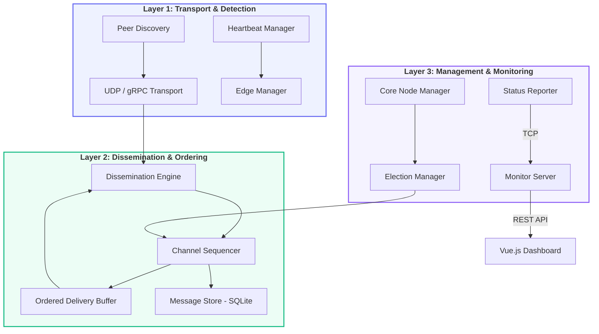
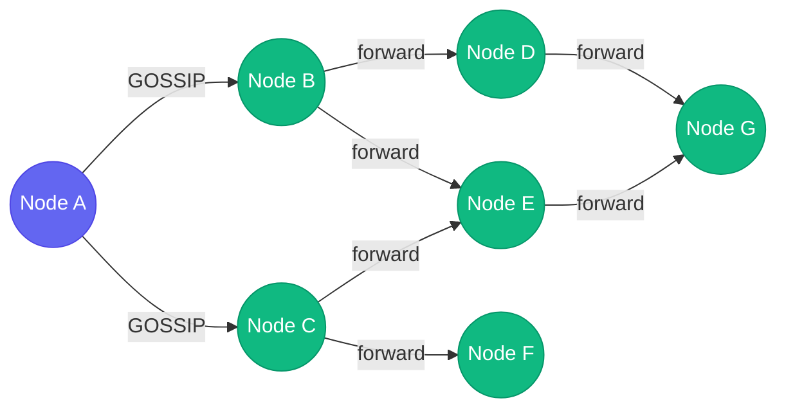
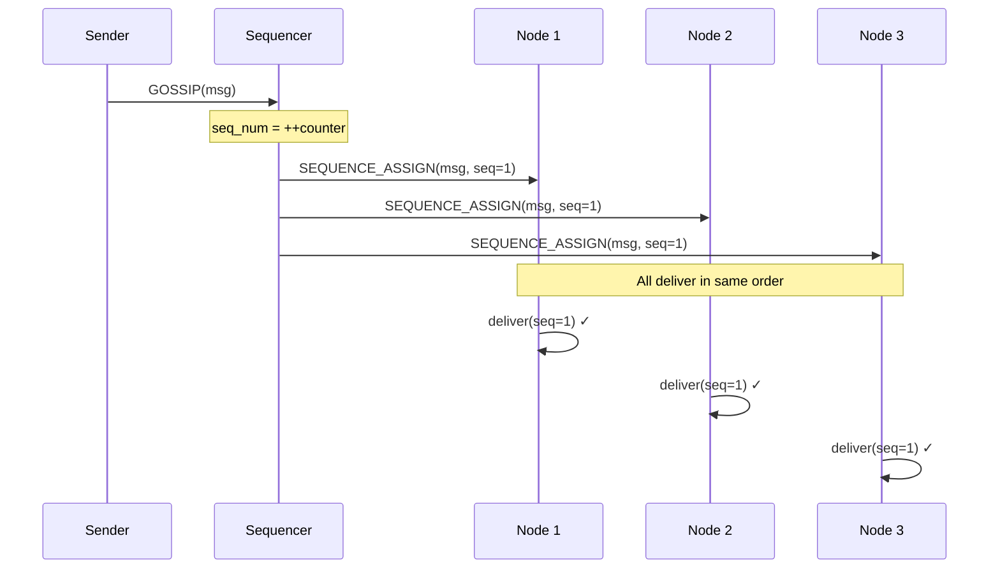
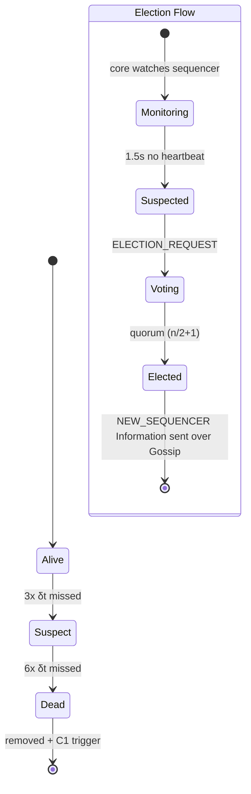
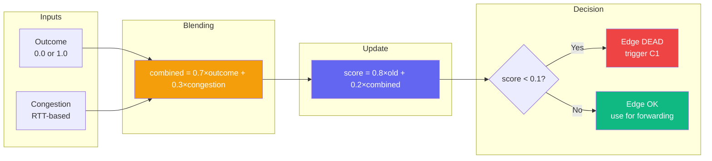
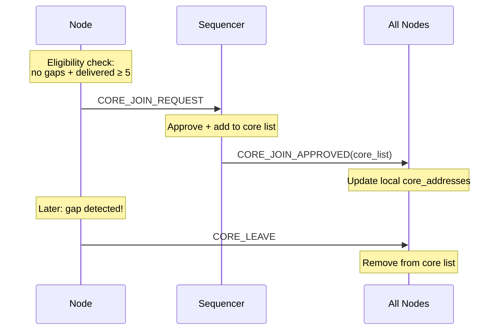
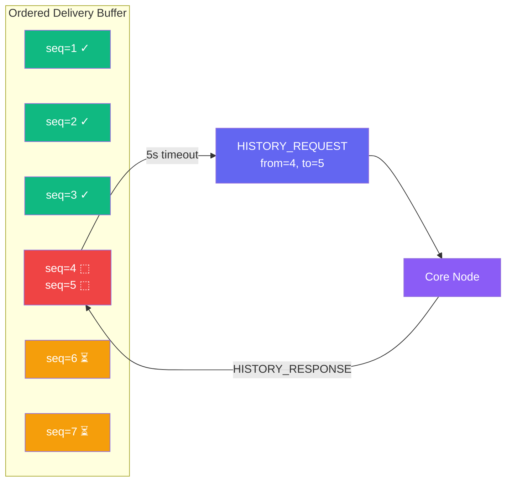

<div align="center">


<br/><br/>

#  Gossip Protocol in P2P Systems

### Epidemic Dissemination with Total Order & Dynamic Sequencer Election

<br/>

<table>
<tr>
<td align="center"><strong>20</strong><br/><sub>Nodes</sub></td>
<td align="center"><strong>3</strong><br/><sub>Channels</sub></td>
<td align="center"><strong>16</strong><br/><sub>Message Types</sub></td>
<td align="center"><strong>O(log n)</strong><br/><sub>Convergence</sub></td>
<td align="center"><strong>< 5s</strong><br/><sub>Failure Detection</sub></td>
<td align="center"><strong>100%</strong><br/><sub>Total Order</sub></td>
</tr>
</table>

<br/>

*A production-grade gossip protocol with total-order delivery, adaptive edge reliability, dynamic core nodes, and quorum-based leader election.*

</div>

<br/>

---

<br/>

##  Overview

<table>
<tr>
<td width="50%">

**Phase I -- Core Protocol**


Push-based epidemic dissemination where each node forwards messages to probabilistically-selected neighbors. Adaptive EMA scoring adjusts edge weights based on delivery success and RTT congestion. Heartbeat-driven failure detection with exponential back-off ensures rapid crash detection.

</td>
<td width="50%">

**Phase II -- Total Order & Enhancements**


Single-sequencer per channel assigns monotonic sequence numbers for total-order delivery. Dynamic core node groups self-organize via eligibility checks. Quorum-based deterministic election handles sequencer crashes. SQLite WAL persistence enables full state recovery.

</td>
</tr>
</table>

<br/>

##  Architecture



<br/>

<details>
<summary><b>Project Structure</b></summary>

```
code/
├── core/                        # Core abstractions
│   ├── node.py                  #   LocalNode, NodeInfo, NeighbourEntry
│   ├── message.py               #   Message, MessageType, LamportClock
│   └── heartbeat.py             #   HeartbeatManager, FailureDetector
│
├── components/                  # Protocol components
│   ├── dissemination.py         #   Gossip forwarding + delivery
│   ├── sequencer.py             #   Total order assignment
│   ├── ordered_delivery.py      #   Seq_num ordering + gap detection
│   ├── core_manager.py          #   Dynamic core group management
│   ├── election.py              #   Sequencer election protocol
│   ├── edge_manager.py          #   EMA probability tracking
│   ├── discovery.py             #   Join + peer exchange
│   ├── storage.py               #   SQLite persistence
│   └── status_reporter.py       #   TCP reporting to monitor
│
├── transport/                   # Network backends
│   ├── udp/                     #   UDP transport + server
│   └── grpc/                    #   gRPC transport + server
│
├── config/                      # Configuration
│   ├── base_config.py           #   All config dataclasses
│   ├── udp_config.py            #   UDP-specific config
│   └── grpc_config.py           #   gRPC-specific config
│
├── monitoring/                  # Monitoring system
│   ├── monitor_server.py        #   TCP listener + aggregation
│   └── api.py                   #   REST API (FastAPI)
│
├── dashboard/                   # Web dashboard (Vue 3)
│   ├── index.html
│   └── static/
│
├── tests/                       # Test suite
├── run_demo.py                  # 30-node multi-channel demo
└── run_demo_grpc.py             # gRPC transport demo
```

</details>

<br/>

##  Quick Start

```bash
# 1. Install dependencies
cd code/
pip install fastapi uvicorn

# 2. Run the 30-node demo
python run_demo.py

# 3. Open dashboard
# http://localhost:9091
```

> **Ports**: `9090` (UDP transport) | `9091` (REST API + Dashboard) | `9092` (TCP status reports)

<br/>

##  Demo Scenario

The demo launches **30 nodes** across **3 channels** (`sensors`, `alerts`, `logs`) and showcases every protocol feature:

```mermaid
gantt
    title Demo Timeline
    dateFormat X
    axisFormat %s

    section Startup
    Monitor starts              :done, 0, 2
    Seed self-elects sequencer  :done, 2, 8

    section Wave Joins
    9 nodes join (7002-7010)    :active, 8, 25
    10 nodes join (7011-7020)   :active, 25, 45

    section Failures
    3 nodes leave gracefully    :crit, 45, 55
    SEQUENCER KILLED - election :crit, 55, 75

    section Recovery
    10 late joiners (history)   :active, 75, 85
    2 nodes rejoin              :active, 85, 105

    section 2nd Election
    2ND SEQUENCER KILLED        :crit, 105, 125
    Node 7012 rejoins           :active, 115, 125
```



<table>
<tr>
<td>

| Time | Event |
|:-----|:------|
| `t=0s` | Monitor starts |
| `t=2s` | Seed (7001) self-elects sequencer |
| `t=8s` | Wave 2: 9 nodes join |
| `t=25s` | Wave 3: 10 more nodes |
| `t=45s` | 3 nodes leave |

</td>
<td>

| Time | Event |
|:-----|:------|
| `t=55s` | **Sequencer killed -- election!** |
| `t=75s` | Wave 4: 10 late joiners |
| `t=85s` | 2 nodes rejoin (recovery) |
| `t=105s` | **2nd sequencer killed!** |
| `t=115s` | Node 7012 rejoins |

</td>
</tr>
</table>

<br/>

##  How It Works

### Epidemic Gossip Dissemination

<table>
<tr>
<td width="55%">



</td>
<td>

**Algorithm:**
1. Dedup check (`msg_id` seen set)
2. Receipt threshold: skip if forwards >= 3
3. Update Lamport clock: `max(local, recv) + 1`
4. Deliver locally if subscribed
5. Forward to neighbors (roll against `edge_prob`)

**Convergence Theorem** *(Demers et al., 1987)*:

> P(all infected) = 1 - n * exp(-f^r / n)
>
> With f=6, n=30, r=3: **P > 99.99%**

</td>
</tr>
</table>

---

### Total Order: Sequencer Protocol



> **Theorem**: If all messages eventually reach all subscribers (epidemic guarantee) and the ordered delivery buffer enforces strict `seq_num` ordering, then **all subscribers deliver messages in identical total order**.

---

### Failure Detection & Election



<table>
<tr>
<td width="50%">

#### Heartbeat Detection

| Threshold | Value | Action |
|:----------|:------|:-------|
| T_suspect | 3 x δt (3s) | Mark SUSPECT |
| T_dead | 6 x δt (6s) | Mark DEAD + remove |
| Back-off | 2x exponential | Max 60s cap |

Based on **diamond-P** *(Chandra & Toueg, 1996)*

</td>
<td width="50%">

#### Election Properties

| Property | Guarantee |
|:---------|:----------|
| **Agreement** | Same winner at all cores (deterministic sort) |
| **Validity** | Only live cores eligible |
| **Termination** | 3s timeout bound |
| **Continuity** | `next_seq = max(last_known) + 1` |

</td>
</tr>
</table>

---

### Adaptive Edge Reliability (EMA)



| Parameter | Value | Description |
|:----------|:------|:------------|
| `lambda_ema` | 0.8 | Smoothing factor (high = stable) |
| `w_reliability` | 0.7 | Weight for delivery outcome |
| `w_congestion` | 0.3 | Weight for RTT congestion |
| `dead_threshold` | 0.1 | Below = edge dead |
| `revival_threshold` | 0.2 | Above = edge revived |

> Based on **Recursive Bayesian Estimation** with congestion blending from **TCP Vegas** *(Brakmo & Peterson, 1995)*

---

### Dynamic Core Nodes



---

### Gap Recovery & History



<br/>

##  Message Types

<table>
<tr>
<td>

**Gossip**
| Type | Purpose |
|:-----|:--------|
| `GOSSIP` | App payload |
| `SEQUENCE_ASSIGN` | Total order |

**Heartbeat**
| Type | Purpose |
|:-----|:--------|
| `HEARTBEAT` | Liveness probe |
| `HEARTBEAT_ACK` | Acknowledgment |

</td>
<td>

**Discovery**
| Type | Purpose |
|:-----|:--------|
| `PEER_LIST_REQ` | Give me peers |
| `PEER_LIST_RESP` | Here are peers |

**History**
| Type | Purpose |
|:-----|:--------|
| `HISTORY_REQ` | Fill my gaps |
| `HISTORY_RESP` | Batch of msgs |

</td>
<td>

**Core Nodes**
| Type | Purpose |
|:-----|:--------|
| `CORE_JOIN_REQ` | Request join |
| `CORE_JOIN_OK` | Approved |
| `CORE_LEAVE` | Depart |

**Election**
| Type | Purpose |
|:-----|:--------|
| `SEQ_HEARTBEAT` | Seq alive |
| `ELECTION_REQ` | Vote |
| `NEW_SEQUENCER` | Result |

</td>
</tr>
</table>

<br/>

##  Configuration

<details>
<summary><b>All Parameters</b></summary>

| Category | Parameter | Default | Description |
|:---------|:----------|:--------|:------------|
| **Heartbeat** | `delta_t` | `1.0s` | Heartbeat interval |
| | `tsuspect_multiplier` | `3` | Beats to SUSPECT |
| | `tdead_multiplier` | `6` | Beats to DEAD |
| **Gossip** | `fmin` / `fmax` | `2` / `6` | Neighbor bounds |
| | `receipt_threshold` | `3` | Max forwards per msg |
| **Edge** | `lambda_ema` | `0.8` | EMA smoothing |
| | `dead_threshold` | `0.1` | Edge death score |
| | `revival_threshold` | `0.2` | Edge revival score |
| **Channel** | `seq_heartbeat_interval` | `0.3s` | Sequencer heartbeat |
| | `seq_heartbeat_timeout` | `1.5s` | Failure timeout |
| | `election_timeout` | `3.0s` | Election timeout |
| | `core_join_min_seq` | `5` | Min delivered to join core |
| **Discovery** | `peer_exchange_interval` | `30s` | Background refresh |
| | `seed_fmax_override` | `50` | Seed neighbor limit |
| **Monitor** | `report_interval` | `1.0s` | TCP report frequency |

</details>

<br/>

##  Dashboard

The real-time monitoring dashboard at `http://localhost:9091` provides:

<table>
<tr>
<td align="center" width="25%">
<h4>Network Graph</h4>
<sub>SVG topology with role colors</sub><br/>
<br/>
<br/>
<br/>

</td>
<td align="center" width="25%">
<h4>Channel View</h4>
<sub>Per-channel overlay</sub><br/><br/>
Highlights subscribers<br/>
Dims non-members<br/>
Shows message flow
</td>
<td align="center" width="25%">
<h4>Message Feed</h4>
<sub>Scrollable history</sub><br/><br/>

<br/><br/>
Real-time updates
</td>
<td align="center" width="25%">
<h4>Node Details</h4>
<sub>Deep inspection</sub><br/><br/>
Neighbors & edge probs<br/>
Buffer stats<br/>
Core/seq status
</td>
</tr>
</table>

> Built with **Vue 3** (CDN) + native **SVG** -- no build step required.

<br/>

##  Theoretical Foundations

<table>
<tr>
<td width="50%">

### Theorems & Guarantees

| Guarantee | Mechanism |
|:----------|:----------|
| **Deduplication** | `msg_id` seen set + forward count <= 3 |
| **FIFO per sender** | Monotonic counter + OutOfOrderBuffer |
| **Total order** | Sequencer `seq_num` + OrderedDeliveryBuffer |
| **Eventual delivery** | Epidemic O(log n) + history recovery |
| **Failure detection** | diamond-P eventually perfect |
| **Election agreement** | Deterministic sort on identical set |
| **Election termination** | Quorum (n/2)+1, 3s timeout |
| **Sequence continuity** | `next_seq = max(known) + 1` |
| **Crash recovery** | SQLite WAL + history catch-up |

</td>
<td width="50%">

### Key Assumptions

| Assumption | Basis |
|:-----------|:------|
| Asynchronous network | No message delay bound |
| Crash-stop failures | No Byzantine behavior |
| Partial connectivity | Overlay via discovery |
| Bounded clock skew | Drift < delta_t |
| Connected overlay | fmin + seed nodes |
| Core quorum survives | Majority alive for election |
| Single seq per channel | Election uniqueness |

</td>
</tr>
</table>

<br/>

##  Tests

```bash
cd code/
python -m pytest tests/ -v
```

| Test | Covers |
|:-----|:-------|
| `test_dissemination.py` | Gossip forwarding, delivery, dedup |
| `test_discovery.py` | Peer exchange, join protocol |
| `test_edge_reliability.py` | EMA convergence, death/revival |
| `test_congestion.py` | RTT tracking, congestion scoring |

<br/>

##  References

| Paper | Contribution to This Project |
|:------|:-----------------------------|
| Demers et al. (1987). *"Epidemic Algorithms for Replicated Database Maintenance."* ACM PODC | Epidemic gossip convergence theory |
| Lamport (1978). *"Time, Clocks, and the Ordering of Events."* CACM | Lamport clocks, causal ordering |
| Chandra & Toueg (1996). *"Unreliable Failure Detectors."* JACM | Diamond-P failure detector model |
| Brakmo & Peterson (1995). *"TCP Vegas."* IEEE JSAC | RTT-based congestion detection |
| Birman et al. (1999). *"Bimodal Multicast."* ACM TOCS | Epidemic + deterministic repair |
| Kermarrec et al. (2003). *"Probabilistic Reliable Dissemination."* IEEE TPDS | Membership + gossip protocols |
| Eugster et al. (2004). *"Epidemic Information Dissemination."* IEEE Computer | Gossip protocol taxonomy |

<br/>

---

<div align="center">
<sub>Built as part of a Distributed Systems course project</sub>
</div>
